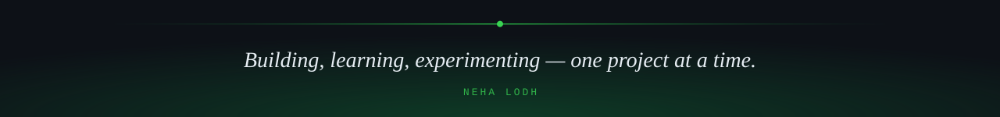

<!--
  SETUP: Find & Replace these placeholders before publishing
  Neha-Lodh           -> your GitHub username (also the name of this repository)
  YOUR-LINKEDIN      -> your LinkedIn handle
  YOUR_EMAIL         -> your email address
  YOUR-PORTFOLIO-URL -> your portfolio site (or delete that badge)
  REPO_NAME / YOUR-DEMO-LINK -> remaining project links (CodeQuest, Nexa AI, InsightFlow demo)
  Lines marked "verify" -> check they match what you actually built
-->

 

<h2 align="center">About</h2>

Hi, I'm <b>Neha</b>, a Computer Science student at the University of Mumbai. 
I enjoy working with data, finding the story inside it, and turning it into something people can use.

My interests sit between <b>data analytics</b>, <b>business analytics</b> and <b>software development</b>, 
with a growing curiosity about <b>AI and machine learning</b>. 
I learn best by building projects, so most of what I know comes from trying things, breaking them and fixing them.

<i>Open to learning opportunities, internships and entry-level roles in data and analytics.</i>

 

<h2 align="center">Tech Stack</h2>

<table align="center">
  <tr>
    <td align="right"><b>Programming</b></td>
    <td>
      
      
    </td>
  </tr>
  <tr>
    <td align="right"><b>Database</b></td>
    <td>
      
      
    </td>
  </tr>
  <tr>
    <td align="right"><b>Data Analytics</b></td>
    <td>
      
      
    </td>
  </tr>
  <tr>
    <td align="right"><b>Web Development</b></td>
    <td>
      
      
      
    </td>
  </tr>
  <tr>
    <td align="right"><b>Tools</b></td>
    <td>
      
      
    </td>
  </tr>
</table>

 

<h2 align="center">Featured Projects</h2>

<table>
  <tr>
    <td width="50%" valign="top">
      <h3>CodeQuest</h3>
      
An interactive coding adventure game that teaches programming through play.

      

        
        
        
      

      <!-- verify: tech used in CodeQuest -->
      <b>Key features</b>
      <ul>
        <li>Story-driven levels that introduce coding concepts step by step</li>
        <li>Interactive challenges with instant feedback</li>
        <li>Game-style progression to keep practice engaging</li>
      </ul>
      <!-- verify: features -->
      <a href="https://github.com/Neha-Lodh/REPO_NAME">Repository</a> &nbsp;|&nbsp; <a href="https://YOUR-DEMO-LINK">Live demo</a>
    </td>
    <td width="50%" valign="top">
      <h3>InsightFlow</h3>
      
An AI-assisted data analysis app: upload a dataset, check its quality, ask questions, explore charts and download a report.

      

        
        
        
        
      

      <b>Key features</b>
      <ul>
        <li>Sign-in and registration for users</li>
        <li>Dataset profiling and data-quality checks</li>
        <li>Ask questions about your data and explore charts</li>
        <li>Excel import and downloadable reports</li>
        <li>Available as both a Flask web dashboard and a Streamlit app</li>
      </ul>
      <a href="https://github.com/Neha-Lodh/insightflow">Repository</a> &nbsp;|&nbsp; <a href="https://YOUR-DEMO-LINK">Live demo</a>
    </td>
  </tr>
  <tr>
    <td width="50%" valign="top">
      <h3>Network Anomaly Detector</h3>
      
A machine learning web app that analyzes network traffic data, detects abnormal activity, scores risk and shows alerts on an interactive dashboard.

      

        
        
        
        
        
      

      <b>Key features</b>
      <ul>
        <li>Isolation Forest and Random Forest combined into a 0&ndash;100 risk score (Low / Medium / High)</li>
        <li>CSV upload with automatic validation and cleaning</li>
        <li>Dashboard, traffic analysis and alerts pages with Chart.js charts</li>
        <li>Alert status tracking (New, Reviewed, Resolved)</li>
      </ul>
      <a href="https://github.com/Neha-Lodh/ml-network-anomaly-detector">Repository</a> &nbsp;|&nbsp; <a href="https://ml-network-anomaly-detector.onrender.com">Live demo</a>
    </td>
    <td width="50%" valign="top">
      <h3>Nexa AI</h3>
      
An intelligent Retrieval-Augmented Generation (RAG) assistant that answers questions using your own data.

      

        
        
        
        
        
        
        
      

      <b>Key features</b>
      <ul>
        <li>Retrieves relevant context from a vector store (ChromaDB)</li>
        <li>Agent workflow orchestrated with LangGraph</li>
        <li>Chat interface built with Streamlit</li>
      </ul>
      <!-- verify: features -->
      <a href="https://github.com/Neha-Lodh/REPO_NAME">Repository</a> &nbsp;|&nbsp; <a href="https://YOUR-DEMO-LINK">Live demo</a>
    </td>
  </tr>
</table>

 

<h2 align="center">GitHub Statistics</h2>

 

 

 

Stats not loading? Fallback views

These widgets are free community services and can occasionally be slow or rate-limited. If any card above looks empty, these alternatives still work:

<a href="https://github.com/Neha-Lodh?tab=repositories&sort=stargazers">Repositories by stars</a> &nbsp;|&nbsp;
<a href="https://github.com/Neha-Lodh?tab=overview">Native contribution graph</a> &nbsp;|&nbsp;
<a href="https://github.com/Neha-Lodh?tab=repositories">All repositories</a>

 

<h2 align="center">Currently Learning</h2>

<table align="center">
  <tr>
    <td align="center" width="33%"><b>Power BI</b> Dashboards and reporting</td>
    <td align="center" width="33%"><b>Tableau</b> Visual storytelling with data</td>
    <td align="center" width="33%"><b>Advanced SQL</b> Joins, window functions, optimisation</td>
  </tr>
  <tr>
    <td align="center"><b>Machine Learning</b> Models, evaluation, real datasets</td>
    <td align="center"><b>Data Visualization</b> Clear, honest charts</td>
    <td align="center"><b>AI and RAG Systems</b> Retrieval, agents, LLM apps</td>
  </tr>
</table>

 

<h2 align="center">Connect With Me</h2>

  
  
  
  

 

<!--
**Neha-Lodh/Neha-Lodh** is a ✨ _special_ ✨ repository because its `README.md` (this file) appears on your GitHub profile.

Here are some ideas to get you started:

- 🔭 I’m currently working on ...
- 🌱 I’m currently learning ...
- 👯 I’m looking to collaborate on ...
- 🤔 I’m looking for help with ...
- 💬 Ask me about ...
- 📫 How to reach me: ...
- 😄 Pronouns: ...
- ⚡ Fun fact: ...
-->
